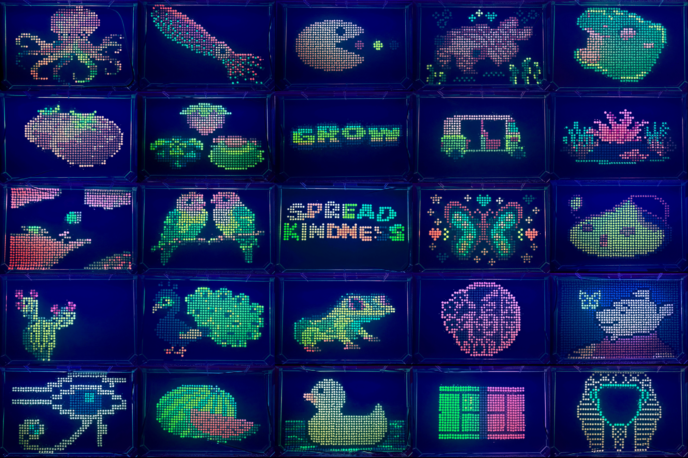
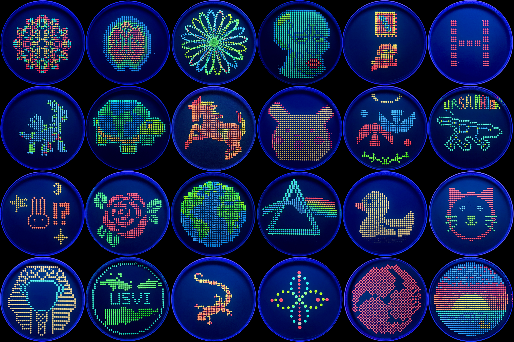

# HTGAA Tools

Web tools for running lab-automation experiments and artwork on
[Ginkgo Nebula](https://www.ginkgo.bio), built for
[How To Grow Almost Anything](https://howtogrowalmostanything.notion.site/htgaa25)
(HTGAA) and How to Biomanufacture (Almost) Anything (HTBAA) at the
[MIT Media Lab](https://www.media.mit.edu).

    

Two things live here:

| | |
| --- | --- |
| **[Cell-Free Synthesis Coopetition](https://coopetition.htgaa.org/cfps)** (`/cfps`) | Design, submit and compare cell-free protein synthesis reactions — for humans and AI agents alike |
| **Lab Automation Artwork** (`/`, `/gallery`) | Make fluorescent bacteria artwork on agar plates and OmniTrays |

## Cell-Free Synthesis Coopetition

Participants design 20 µL cell-free reactions for three target proteins; the
best are run on Ginkgo's automated cloud lab. Lowest **specific cost** wins
($/g, or $/unit of enzyme activity).

<p align="center">
  
  
  
</p>
<p align="center">
  <b>sfGFP</b> fluorescent reporter ·
  <b>PETase</b> degrades PET plastic ·
  <b>Reteplase</b> clot-busting drug, nine disulfide bonds
</p>

Reaction designer with live concentrations, cost and benchmarks · range checks
ported from `autonomous-cfps` that catch a design that can't run before it's
submitted · batches, stars, comments and a shared literature list ·
[agent API](static/cfps/skill.md) so AI agents can take part · 384-well plate
maps exported as a validated `PlateBatch`. Community data is visible to
signed-in participants only.

## Lab Automation Artwork

A graphical interface for making fluorescent bacteria artwork with lab
automation equipment.

- User interface for 100mm agar plate coordinates or 1536-well OmniTrays.
- Share designs to an open-source gallery.
- UV light photography image gallery.

## Want to Make Fluorescent Artwork at Your Lab?
CSV files are downloadable for all designs and support upload to:
- Echo 525 
- Opentrons OT-2

## HTGAA 2026 Results



## HTGAA 2025 Results


## Ginkgo Nebula Automation Videos
*Source plate being loaded into Echo525*

https://github.com/user-attachments/assets/8da71b3c-c460-4333-b0d5-8505eb7604a5

*Destination OmniTray being loaded into Echo525*

https://github.com/user-attachments/assets/4bb5604c-7fe9-46a9-9688-6a5c89801a2c

## Website Development

Feature additions are welcome.

### 1. Install and run

```bash
git clone git@github.com:RonanChance/htgaa-automation.git
cd htgaa-automation
npm install
npm run dev
```

The site comes up without any configuration, but the CFPS section needs
database credentials (next step) — without them `/cfps` loads with an empty
reagent list.

### 2. Environment

Create a `.env` in the repo root. Nothing here is in git.

```bash
PB_EMAIL=                 # PocketBase superuser — required for /cfps
PB_PASSWORD=
PB_URL=https://db.rcdonovan.com

KEYCLOAK_ISSUER=          # only needed to sign in locally
KEYCLOAK_CLIENT_ID=
KEYCLOAK_CLIENT_SECRET=
KC_SESSION_SECRET=        # optional; falls back to PB_PASSWORD
```

> [!NOTE]
> **Localhost reads and writes the live production PocketBase.** This is
> deliberate — `/cfps` previews the real community data as it stands. It also
> means votes, stars, comments and composition submissions made while
> developing are real, landing in production under the signed-in user (the
> "Dev Preview" dummy on localhost). If you want to work offline or try
> something destructive, set `CFPS_DEV_STUBS=1` to swap in in-memory dummy
> stores; the flag is ignored in production builds.

### 3. CFPS cluster data

The cluster export (`/cfps/clusters`) names every submitted design with its
author, recipe and model forecast, so it is **not** in this repo and **not** in
`static/`. It lives in PocketBase and is served only to signed-in users.

To pull it down for local analysis, all you need is a **CFPS agent token** —
sign in to the site, switch the *Participate* section to **Agent**, and click
*Create agent token*:

```bash
npm run clusters:fetch -- --token=<agent token>
```

That writes `data/cfps-clusters/` (gitignored) with both files unpacked as
plain JSON:

```js
const d = require('./data/cfps-clusters/clusters_designs.json');
d.proteins.sfGFP.designs.length;  // 549
```

Maintainers refreshing the export (needs `PB_EMAIL` / `PB_PASSWORD`):

```bash
npm run clusters:refresh -- --arena=../cfps-arena --apply   # re-export, then publish
npm run clusters:publish -- --dir=<export dir> --apply      # publish an export you already have
```

Both dry-run unless you pass `--apply`. Full details, including a cron example
for nightly refreshes, are in [`tools/README.md`](tools/README.md).

### 4. Other tooling

| Command | What it does |
| --- | --- |
| `npm run build` | production build (adapter-node) |
| `npm run sync:cfps` | regenerate the CFPS reagent contract from `autonomous-cfps` |
| `npm run check:cfps-range` | verify the JS range checks still match the Python |

`npm run sync:cfps` needs [`uv`](https://docs.astral.sh/uv/) and a sibling
`autonomous-cfps` checkout; see [`tools/README.md`](tools/README.md).

### Tech Stack

- **Frontend**: [SvelteKit](https://kit.svelte.dev/), [JavaScript](https://en.wikipedia.org/wiki/JavaScript)
- **Backend**: [Node.js](https://nodejs.org/)
- **Database**: [PocketBase (SQLite)](https://pocketbase.io)
- **Hosting**: [DigitalOcean Droplet, Spaces](https://digitalocean.com)
